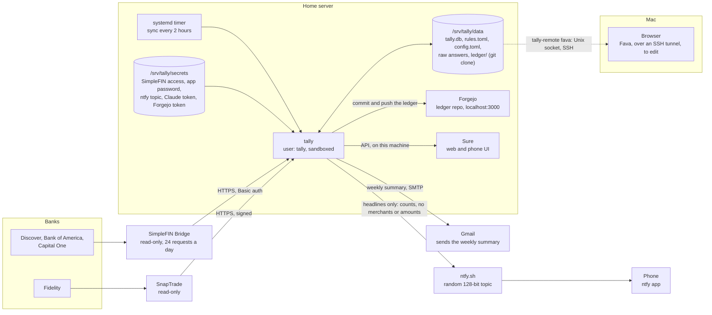
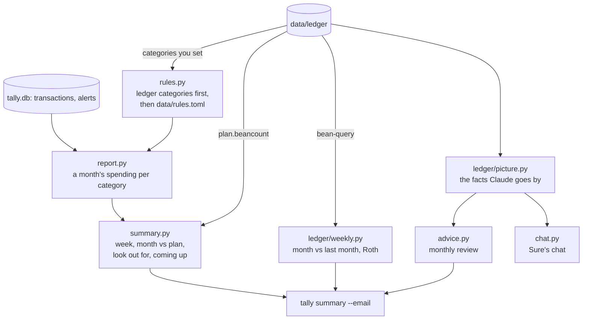
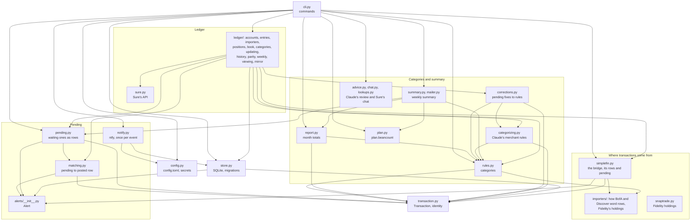
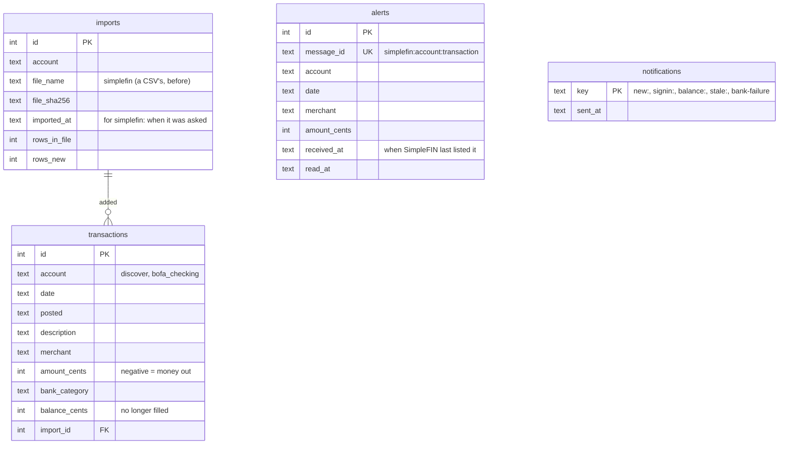
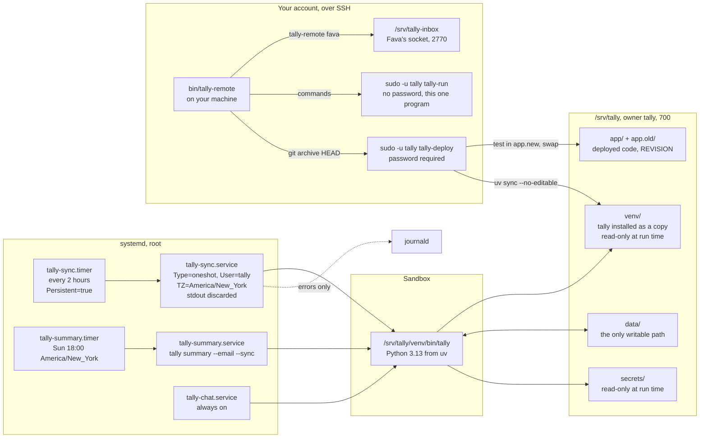

# Architecture

tally runs on one home server. What it knows about your bank and card accounts comes from
SimpleFIN Bridge, which reads them for you: posted transactions, pending ones, and each
account's balance. Fidelity holdings come from SnapTrade. It keeps a Beancount ledger (pushed to its own repo on
Forgejo, edited with Fava), fills Sure from it, emails a weekly summary and sends
headline-only push notifications.

## The whole system



Solid lines run on their own; dotted lines are steps you do by hand.

## Trust boundaries

| Boundary | What crosses it | What protects it |
|---|---|---|
| Banks → SimpleFIN → tally | Transactions and balances | SimpleFIN holds the bank connections; tally holds only an access URL, read-only, in secrets/, never printed or logged. Its rows are checked against what's stored (same posted date and amount) and each account's balance against the ledger's. |
| tally → Forgejo | The ledger | A token for the one repo, in secrets/, given to git through its environment (never its command line or config). Forgejo is reached on localhost. |
| Fava → you | The ledger, read and edit | Runs only while `tally-remote fava` is open, on a Unix socket in a folder only your account and tally can open; SSH forwards it to your machine. |
| Sure → tally chat | Your chat messages; replies from the ledger | `tally chat` listens on a Unix socket, reached only through a relay container on Sure's own network with no port on the server, and answers only requests carrying the token Sure was given. Claude's only tools are Sure's lookups that read, passed on by `tally lookups`, which holds Sure's MCP token and refuses every other tool. A reply quoting a dollar amount that neither the ledger, the chat nor a lookup shows is refused. |
| tally → ntfy | Headlines | ntfy topics have no password, so the topic is 128 random bits and messages carry only kinds and counts. |
| Server | Everything | A `tally` user with no login, sudo or docker. `/srv/tally` is 700. The systemd sandbox allows writes to `/srv/tally/data` only. Files are 600 and folders 700. |

## Every two hours: sync

```mermaid
sequenceDiagram
    autonumber
    participant T as systemd timer
    participant C as cli.py
    participant B as simplefin.py
    participant U as ledger/updating.py
    participant S as store.py: tally.db
    participant L as data/ledger
    participant N as notify.py

    T->>C: tally sync
    C->>B: fetch the last 14 days
    alt can't be asked
        C->>N: SimpleFIN failed: announced once it has lasted 3 h, then every 6 h
    else answered
        U->>S: posted rows not stored yet (same posted date and amount)
        U->>L: their entries, categorized by the rules
        U->>S: each pending transaction, as an alert; when it was asked
    end
    U->>U: categories set on pending entries become rules; Claude for new merchants
    U->>L: pending.beancount: what SimpleFIN last listed
    U->>L: Fidelity holdings from SnapTrade
    U->>U: every row once, bean-check, each balance against the bank's
    U->>U: Sure made to match the ledger
    C->>N: new pending purchases, banks to sign in to again, balances that differ
    N->>S: which keys were already announced?
    N->>N: one POST per kind, most urgent first; keys recorded once ntfy accepts
```

## Reports and the summary



## Modules

An arrow means "imports". `cli.py` is the only entry point. The parsers know nothing about
storage, and the ledger package knows nothing about notifications.



## Database

`data/tally.db`, SQLite. Money is stored as integer cents, and dates as ISO text. The schema
version is stored in `PRAGMA user_version`, and `store.connect` runs any missing migrations.



Pending transactions are never joined to posted ones in the database. Matching is recomputed
on every run, and pending.beancount is worked out afresh each time, so a late or corrected
answer fixes the picture without any cleanup. Alerts from the alert emails tally used to read
are still in the table; SimpleFIN's answers cover them.

## On the server



Sandbox settings in `deploy/tally-sync.service`:
- **Filesystem:** `ProtectSystem=strict` with `ReadWritePaths=/srv/tally/data`, `ProtectHome`, `PrivateTmp`, `PrivateDevices`.
- **Privileges:** `NoNewPrivileges`, an empty `CapabilityBoundingSet`, `RestrictSUIDSGID`.
- **Network and system calls:** only internet and local sockets (`RestrictAddressFamilies`), and only the `@system-service` system calls.
- **Kernel, clock, hostname and processes:** all protected.

See [Running on a server](server.md) for installing and updating.
