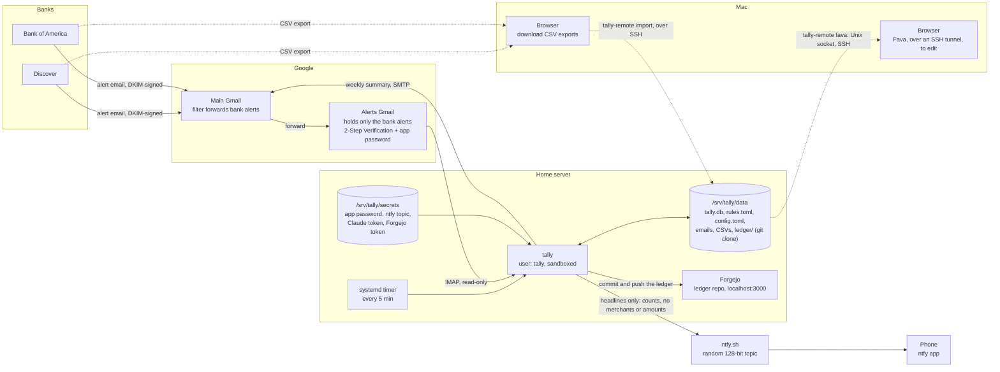
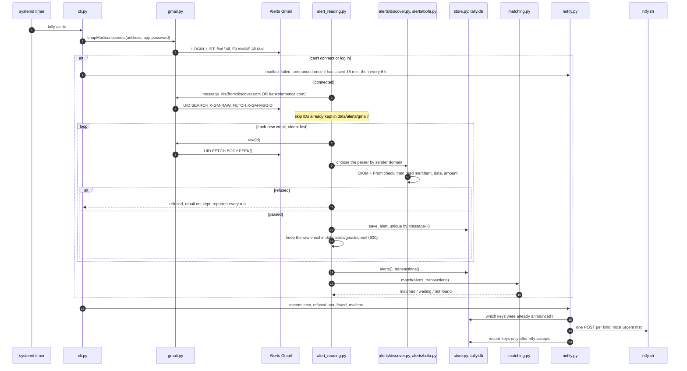
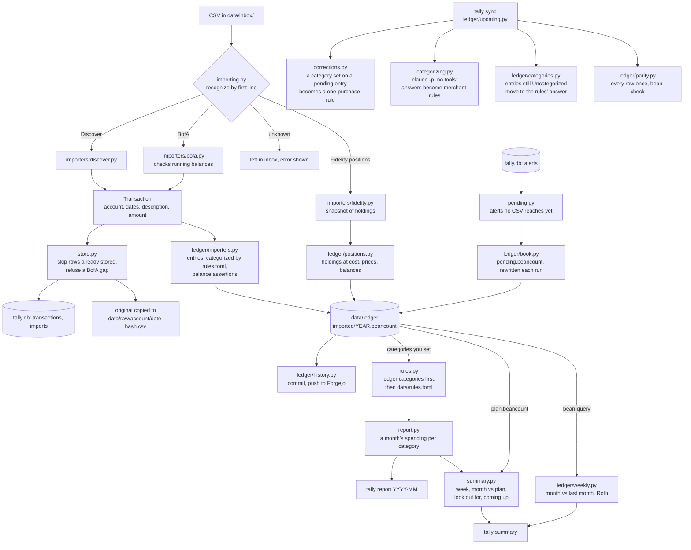
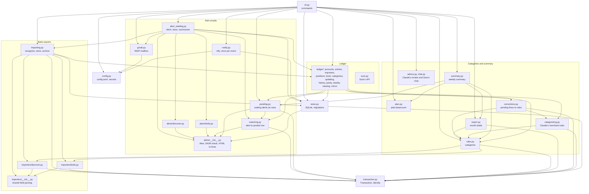
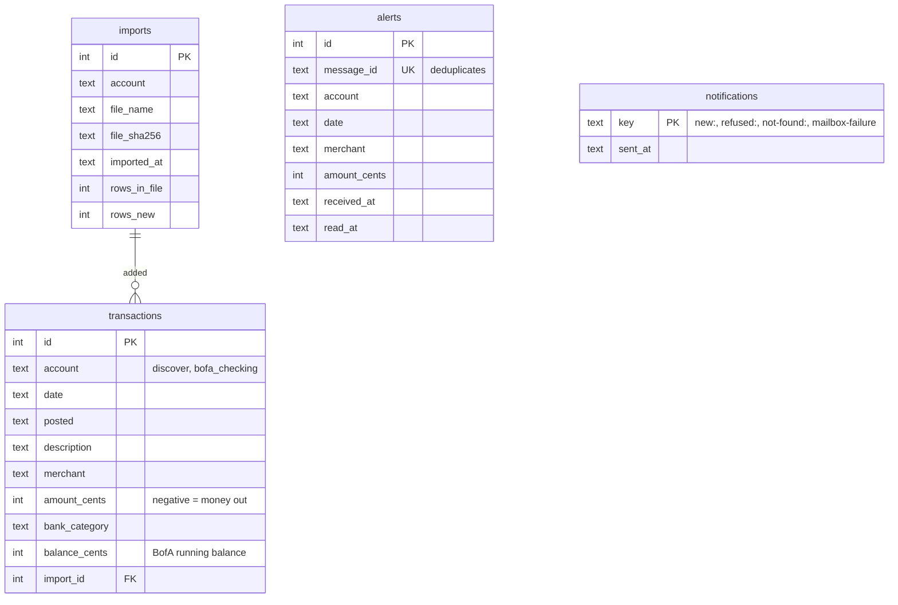
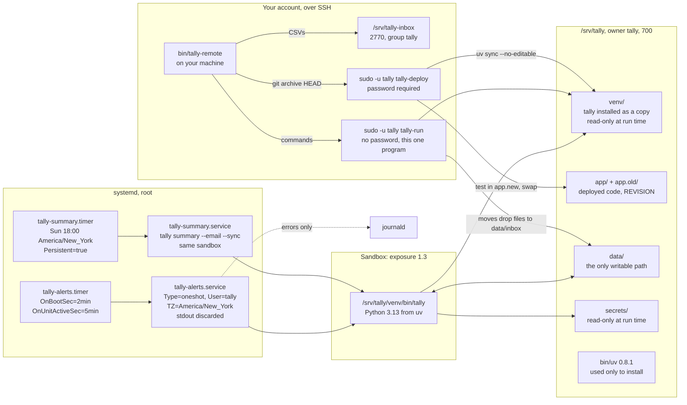

# Architecture

tally runs on one home server. Everything it knows comes from two sources: the CSV exports
you download from each bank, which are the record of what posted, and the alert emails the
banks send at purchase time, which are provisional and give early warning. It keeps a
Beancount ledger (pushed to its own repo on Forgejo, edited with Fava), emails a weekly
summary and sends headline-only push notifications. There are no bank logins and no
aggregators.

## The whole system

Solid lines run on their own; dotted lines are steps you do by hand.

## Trust boundaries

| Boundary | What crosses it | What protects it |
|---|---|---|
| Bank → alerts mailbox | Alert emails | An email counts only if Gmail's topmost `Authentication-Results` header shows `dkim=pass` for the bank's domain and the From address is the bank's. A forged email is refused and reported. |
| Alerts mailbox → tally | Raw emails | An app password for an account that holds nothing but bank alerts. The mailbox is opened with `EXAMINE` and read with `BODY.PEEK`, so tally can't change it. |
| CSV → database | Posted transactions | The bank is recognized by file contents. BofA running balances must add up, and a gap in its history stops the import. Rows are deduplicated by identity. |
| tally → Forgejo | The ledger | A token for the one repo, in secrets/, given to git through its environment (never its command line or config). Forgejo is reached on localhost. |
| Fava → you | The ledger, read and edit | Runs only while `tally-remote fava` is open, on a Unix socket in a folder only your account and tally can open; SSH forwards it to your machine. |
| Sure → tally chat | Your chat messages; replies from the ledger | `tally chat` listens on a Unix socket, reached only through a relay container on Sure's own network with no port on the server, and answers only requests carrying the token Sure was given. Claude's only tools are Sure's lookups that read, passed on by `tally lookups`, which holds Sure's MCP token and refuses every other tool. A reply quoting a dollar amount that neither the ledger, the chat nor a lookup shows is refused. |
| tally → ntfy | Headlines | ntfy topics have no password, so the topic is 128 random bits and messages carry only kinds and counts. |
| Server | Everything | A `tally` user with no login, sudo or docker. `/srv/tally` is 700. The systemd sandbox allows writes to `/srv/tally/data` only. Files are 600 and folders 700. |

## Every 5 minutes: alerts

## By hand: import, report, sync

## Modules

An arrow means "imports". `cli.py` is the only entry point. The parsers know nothing about
storage, and the ledger package knows nothing about email or notifications.

## Database

`data/tally.db`, SQLite. Money is stored as integer cents, and dates as ISO text. The schema
version is stored in `PRAGMA user_version`, and `store.connect` runs any missing migrations.

Alerts are never joined to transactions in the database. Matching is recomputed on every
run, so a late or corrected CSV fixes the picture without any cleanup. The same goes for
pending alerts in the ledger: pending.beancount is worked out afresh on every run.

Two tables from before the ledger, `sheet_writes` and `sheet_categories`, are still in the
database but nothing uses them.

## On the server

Sandbox settings in `deploy/tally-alerts.service`:
- **Filesystem:** `ProtectSystem=strict` with `ReadWritePaths=/srv/tally/data`, `ProtectHome`, `PrivateTmp`, `PrivateDevices`.
- **Privileges:** `NoNewPrivileges`, an empty `CapabilityBoundingSet`, `RestrictSUIDSGID`.
- **Network and system calls:** only internet and local sockets (`RestrictAddressFamilies`), and only the `@system-service` system calls.
- **Kernel, clock, hostname and processes:** all protected.

See [Running on a server](server.md) for installing and updating.
